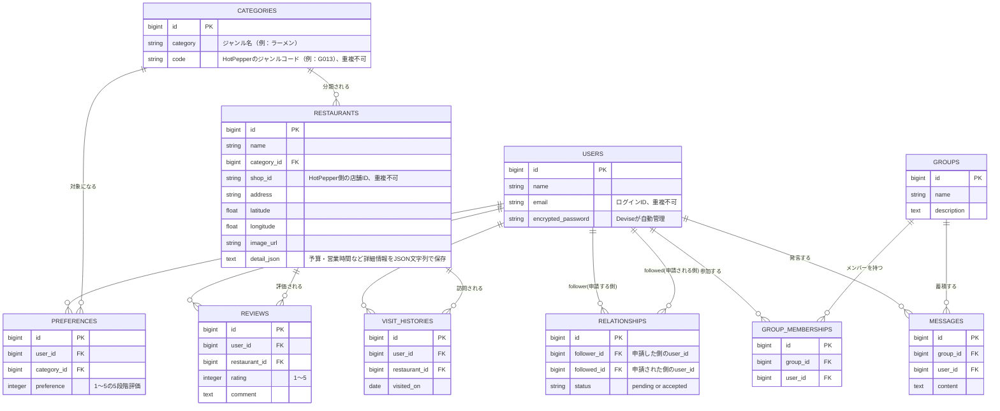

# recommend_app（今日の食事決め太郎）

> このセクションは「どのフォルダ・ファイルに何が入っているか」をすぐ思い出せるようにするための構成メモ。初めてこのリポジトリを見る人でも読めるように書いている。

## 📁 トップレベルの構成

- `app/` — アプリ本体のコード（コントローラ・モデル・ビューなど）。普段の開発で一番よく触る場所
- `config/` — アプリの設定ファイル一式（ルーティング、DB接続設定、APIキーなど）
- `db/` — データベースの設計情報（マイグレーション・スキーマ）と初期データ
- `storage/` — 実際のデータベースファイル（SQLite）本体が入っている場所
- `lib/tasks/` — 自作のrakeタスク（独自コマンド）置き場
- `test/` — 自動テストのコード
- `public/` — 404ページなど静的ファイル
- `bin/` — `bin/rails`や`bin/setup`などの実行スクリプト
- `script/` — その他の補助スクリプト置き場（現状ほぼ空）
- `log/` — アプリ実行時のログファイルが出力される場所
- `tmp/` — キャッシュやpidファイルなどの一時ファイル置き場
- `vendor/` — 外部ライブラリを手動で置く場所（現状未使用）
- `node_modules/` — JavaScript系パッケージの実体（yarn/npmでインストールされたもの）
- `.github/` — GitHub Actions（CI、自動テスト実行）の設定
- `.kamal/` — Kamalというデプロイツールの設定・フックスクリプト
- `.ruby-lsp/` — エディタのRuby言語サーバーのキャッシュ。消しても自動で再生成される
- `.json/` — Claude Code（AIアシスタント）のローカル権限設定置き場
- `Gemfile` / `Gemfile.lock` — 使用しているRubyのgem（ライブラリ）の一覧とバージョン固定情報
- `package.json` / `yarn.lock` — 使用しているJS系パッケージの一覧とバージョン固定情報
- `Dockerfile` / `.dockerignore` — 本番環境用のDockerイメージ定義
- `config.ru` — Rackサーバー起動用の設定ファイル（通常は触らない）
- `Rakefile` — rakeコマンドの読み込み設定（通常は触らない）
- `Guardfile` — ファイル変更を監視して自動でテストを実行する`guard`の設定
- `.rubocop.yml` — Rubyのコードスタイルを自動チェックする`rubocop`の設定
- `.ruby-version` — このプロジェクトで使うRubyのバージョン指定
- `ER.xml` / `ER図.drawio` / `ER図.xlsx` / `テーブル定義書.xlsx` — 作図ツール（draw.io/Excel）で編集したER図・テーブル定義書（※実装と完全には同期していないことがあるので、正確な構造を知りたいときは後述の`db/schema.rb`を見るのが確実）
- `中間発表スライド.html` — 中間発表用に作ったスライド

## 📁 app/ 配下の詳細

### app/controllers/ — リクエストを受けて処理する窓口
- `application_controller.rb` — 全コントローラの親クラス（共通処理を書く場所）
- `survey_controller.rb` — アプリの主要機能がほぼ全部ここに集まっている（トップページ、マイページ、アンケートフォーム、フレンド一覧、グループ一覧・チャット、飲食店検索、飲食店詳細、訪問履歴）
- `users_controller.rb` — 他ユーザーの嗜好パラメータ閲覧（フレンドのみ閲覧可）
- `relationships_controller.rb` — フレンド申請の送信・承認・解除
- `users/` — Devise（認証gem）用にカスタマイズしたログイン・新規登録・パスワード再発行などのコントローラ一式

### app/models/ — データとそのルールを表すクラス（詳細は下の「テーブルとリレーション」参照）
- `application_record.rb` — 全モデルの親クラス
- `user.rb`, `category.rb`, `group.rb`, `group_membership.rb`, `message.rb`, `preference.rb`, `relationship.rb`, `restaurant.rb`, `review.rb`, `visit_history.rb`

### app/services/ — 外部APIや複雑な計算処理をまとめたクラス
コントローラやモデルに直接書くには複雑すぎる処理の置き場（Railsの標準ディレクトリではなく、このプロジェクトで追加した置き場所）
- `hotpepper_client.rb` — HotPepperグルメサーチAPI（外部の飲食店検索API）を呼び出して、結果を`Restaurant`としてDBに保存するクラス
- `recommend_score.rb` — おすすめ度を計算するクラス。個人向けは「アンケートで答えた好み評価×20=マッチ率%」、グループ向けは論文の計算式（平均 ÷ (1+標準偏差)。メンバーの誰か1人でも「大嫌い」なジャンルは0点にする）でスコアを出し、上位ジャンルに属する飲食店を返す

### app/views/ — 画面のHTML（ERBテンプレート）
- `survey/` — 実際に使われている画面一式（ホーム・マイページ・アンケート・フレンド・グループ・グループチャット・検索・飲食店詳細・訪問履歴）
- `users/` — Deviseのログイン・登録・パスワード再発行画面、および`users_controller#show`用のテンプレート
- `layouts/` — 全画面共通のヘッダーやHTMLの土台
- `devise/` — ⚠️ 現在未使用。`rails g devise:views`コマンドで自動生成されたデフォルトのテンプレート。実際はコントローラが`users`名前空間を使っているため読み込まれていない
- `foods/` — ⚠️ 現在未使用。どのコントローラ・ルーティングからも参照されていない、開発初期の試行錯誤の残骸と思われるフォルダ。削除しても動作に影響しない

### app/javascript/ — フロントエンドのJS（Stimulus）
- `application.js` — JSのエントリーポイント
- `controllers/` — Stimulusコントローラ（`hello_controller.js`はRails標準の雛形サンプルで実質未使用）

### app/helpers/, app/jobs/, app/mailers/ — Rails標準の雛形（現状ほぼ空）
- `application_helper.rb`, `survey_helper.rb`, `users_helper.rb` — ビューで使う補助メソッド置き場
- `application_job.rb` — 非同期処理（ActiveJob）の親クラス。まだ具体的なジョブは未実装
- `application_mailer.rb` — メール送信の親クラス。Deviseのパスワード再発行メールなどが利用

### app/assets/ — CSS・画像
- `stylesheets/application.css`, `stylesheets/custom.scss` — 見た目のスタイル定義
- `images/` — 画像置き場（現状空）

## ⚙️ config/ 配下の重要ファイル

- `routes.rb` — URLとコントローラの対応表（例：`/search` → `survey#search`）
- `database.yml` — どのDBファイルを使うか定義（詳細は次のセクション）
- `credentials.yml.enc` + `master.key` — 暗号化されたAPIキーの金庫と、それを開ける鍵。`master.key`は`.gitignore`済みでGit管理対象外
- `environments/` — development（開発）・test（テスト）・production（本番）ごとの設定差分
- `initializers/devise.rb` — 認証（Devise）の詳細設定
- `storage.yml` — Active Storage（ファイルアップロード機能）の保存先設定。現状この機能自体は未使用
- `puma.rb` — Webサーバー（Puma）の設定
- `importmap.rb` — JSライブラリの読み込み設定（node_modulesをバンドルせずブラウザに直接読み込ませる仕組み）

## 🗄️ データベースの実体はどこにある？

- 使っているDBは**SQLite**（`config/database.yml`で指定）。本番用のサーバー（MySQLやPostgreSQLのような別プロセス）は立てておらず、ファイル1つがDBそのもの
- 実データファイルは以下の場所にある。普段ブラウザで操作しているデータは全部これらのファイルの中身
  - `storage/development.sqlite3` — 開発環境（`rails server`で動かしている時）のデータ
  - `storage/test.sqlite3` — テスト実行時だけ使われる使い捨てのデータ
- テーブルの「設計変更履歴」は`db/migrate/`配下に時系列で並んでいる（例：いつ`restaurants`テーブルに`image_url`カラムを追加したか、など1ファイル＝1回の変更）
- `db/schema.rb` — 全マイグレーションを適用した「今の最終形」を1ファイルにまとめたもの。**実際のテーブル構造を確認したいときはここを見るのが一番正確**
- `db/seeds.rb` — `bin/rails db:seed`で投入される初期データ。HotPepper APIの「ジャンルマスタ」17種類（居酒屋・和食・ラーメン…）を`categories`テーブルに登録する

中身を直接のぞきたいときはターミナルで以下を実行するとSQLiteに接続できる：
```
bin/rails dbconsole
```

## 🔗 テーブルとリレーション（`db/schema.rb`に準拠した正確な構造）



### リレーションの読み方（初学者向け）
- `USERS ||--o{ PREFERENCES` は「1人のユーザーは複数のPreference（好み回答）を持てるが、1つのPreferenceは1人のユーザーにしか属さない」という意味（1対多）
- `RELATIONSHIPS`はフレンド機能のための中間テーブルで、`follower_id`（申請した人）と`followed_id`（申請された人）という2つの`user_id`を持つ。1つのテーブルで双方向の関係を表すため、`User`モデル側では`active_relationships`（自分が送った側）と`passive_relationships`（自分が受け取った側）という2つの名前で区別している
- `GROUP_MEMBERSHIPS`は`users`と`groups`の多対多（1ユーザーが複数グループに入れて、1グループに複数ユーザーがいる）を実現するための中間テーブル
- `PREFERENCES`も同様に`users`と`categories`の多対多を仲介する中間テーブル（「このユーザーはこのジャンルをどれくらい好きか」を1行で表す）
- `RESTAURANTS.detail_json`はカラムを増やさずに、HotPepper APIから来た様々な追加情報（キャッチコピー・予算・営業時間・駐車場有無など）をJSON文字列としてそのまま1カラムに保存する設計。`Restaurant#detail`メソッドでHashに変換して取り出せる

## 🧭 主な画面とURL（`config/routes.rb`より）

| URL | 処理するアクション | 画面の内容 |
|---|---|---|
| `/` | `survey#home` | トップページ |
| `/users/sign_in` 等 | Devise標準 | ログイン・新規登録・パスワード再発行 |
| `/mypage` | `survey#mypage` | マイページ（おすすめ飲食店など） |
| `/form` | `survey#form` / `update_preferences` | 好みアンケートの入力・保存 |
| `/friends` | `survey#friends` | フレンド一覧・申請一覧 |
| `/relationships` | `relationships_controller` | フレンド申請の送信・承認・解除 |
| `/groups`, `/groups/:id` | `survey#groups` / `group_chat` | グループ一覧・グループチャット |
| `/search` | `survey#search` | 飲食店検索（HotPepper API利用） |
| `/restaurants/:id` | `survey#restaurant` | 飲食店詳細 |
| `/visit_histories`, `/visit_histories/:id` | `survey#visit_histories` / `visit_history` | 訪問履歴一覧・詳細 |
| `/users/:id` | `users_controller#show` | 他ユーザーの嗜好パラメータ閲覧（フレンドのみ） |

---

This README would normally document whatever steps are necessary to get the
application up and running.

Things you may want to cover:

* Ruby version

* System dependencies

* Configuration

* Database creation

* Database initialization

* How to run the test suite

* Services (job queues, cache servers, search engines, etc.)

* Deployment instructions

* ...

-deviseの説明-
Depending on your application's configuration some manual setup may be required:

  1. Ensure you have defined default url options in your environments files. Here
     is an example of default_url_options appropriate for a development environment
     in config/environments/development.rb:

       config.action_mailer.default_url_options = { host: 'localhost', port: 3000 }

     In production, :host should be set to the actual host of your application.

     * Required for all applications. *

  2. Ensure you have defined root_url to *something* in your config/routes.rb.
     For example:

       root to: "home#index"

     * Not required for API-only Applications *

  3. Ensure you have flash messages in app/views/layouts/application.html.erb.
     For example:

       <p class="notice"><%= notice %></p>
       <p class="alert"><%= alert %></p>

     * Not required for API-only Applications *

  4. You can copy Devise views (for customization) to your app by running:

       rails g devise:views

     * Not required *
# Todoリスト
① ER図を完成させる
② モデルの関連をRailsコードで書いてみる
③ migrationをまとめて作成する
④ ワイヤーフレームを作る
⑤ route設計
⑥ Devise導入（認証）
⑦ 主要CRUDを作って動かす

# 内容
概要
現代社会において、友人やグループでの飲食店選定は、個人の嗜好の多様性や情報過多により、しばしば非効率的なプロセスとなっている。本研究で提案する「今日の食事決め太郎」は、この課題を解決するためのパーソナライズされたソーシャル型飲食店推薦ウェブアプリケーションである。
本システムは、ユーザのレビューフィードバックに基づく学習型レコメンドエンジンを中核とし、料理ジャンル、予算、移動距離、雰囲気といった嗜好パラメータを動的に更新・可視化する。さらに、フレンドの嗜好パラメータ相互閲覧機能や、候補店舗を共有できるグループチャット機能といったソーシャル要素を統合することで、集団意思決定プロセスを支援する。
これにより、利用者は個人の好みに最適化されたレコメンドを受け取るとともに、他者の好みを考慮した効率的かつ合意形成が容易な食事場所決定を実現する。本アプリケーションは、従来の検索ベースのプラットフォームに対し、パーソナライゼーションとソーシャルコラボレーションの側面で優位性を示す。

機能
・ユーザ登録並びにdeviseを用いた認証機能(名前・ID・Email登録)
・ログイン/ログアウト機能
・フレンド登録/削除機能
・飲食店検索機能(飲食店はHotpepperAPIを利用)
・グループ作成/参加機能(フレンドをグループへ招待、グループへ参加可能)
・グループ内チャット機能(LINEのようなトークルームをイメージ)
・レコメンドによって訪れた飲食店に対するレビュー機能
・食事/属性嗜好アンケート機能(食事の好き嫌いの5段階評価＋
飲食店の価格帯・サービス内容の好みのチェックボックス形式のアンケート)
・訪れた飲食店の履歴確認機能(過去に自分やフレンドがその店につけた評価の確認やお店の概要、位置をマップ上で確認可能)
・マイページ上での個人向け飲食店推薦機能(アンケート機能によるユーザ地震に対する飲食店の表示)
・フィードバック機能(ユーザが本アプリを利用した際の意見を入力する機能)
・各ユーザの嗜好パラメータ確認機能(アンケート機能の嗜好情報がベース)
・レビュー後のユーザ嗜好情報の自動調整


中間発表フィードバック
・価格帯の絞り込み→APIあるから実装可能◎
・皆の間をとるのもいいが、一人がここ行きたいってところに行くことも多い
→使う場面の明確化　→発表に向けて定義づけ必要◎

・店の雰囲気をレコメンドの参照にするべき　→食べログAPIのコストかかるから△
・検索ボタンの位置が分かりにくい→修正可能◎
・場所決めのオプション→google place apiコストかかるから△
・リアルタイムの空き状況→そのお店が公開しているかによるしAPIでは閲覧できない✖
・個人向けにもレコメンドしてほしい
→ユーザへのおすすめにユーザベース協調フィルタリング導入？(コサイン類似度によるコーディング)https://leisurelab.hatenablog.com/entry/user-based-cf△
